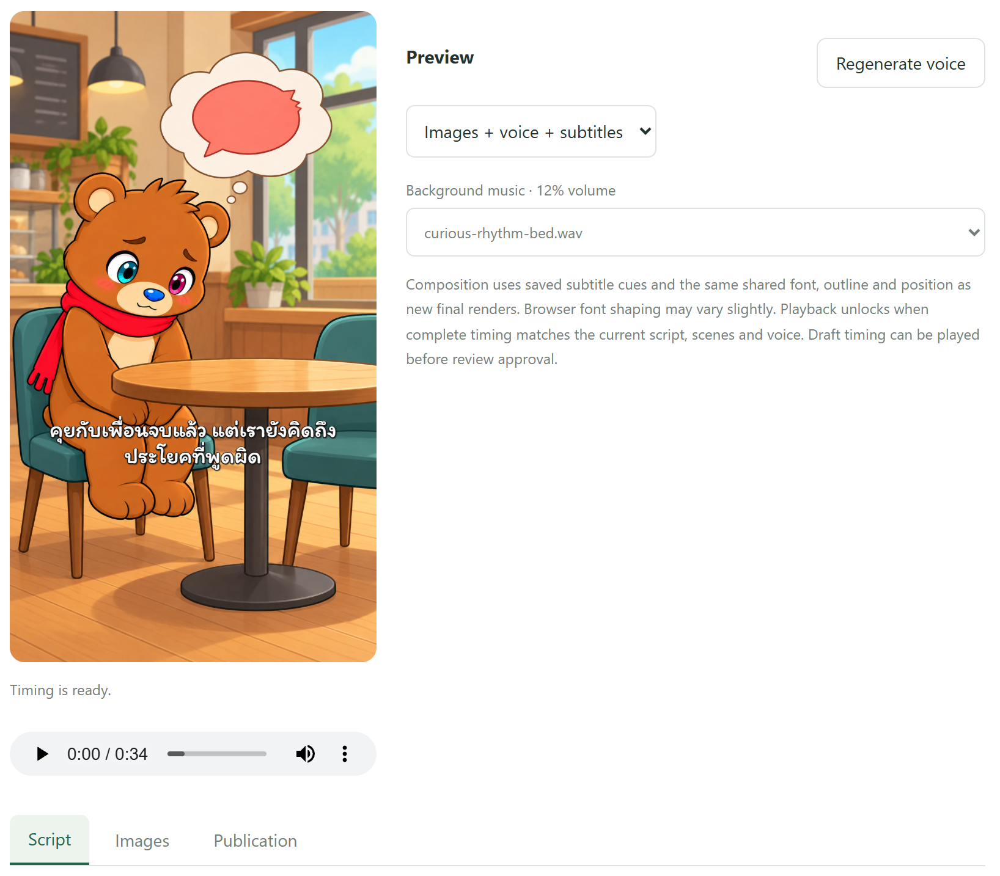
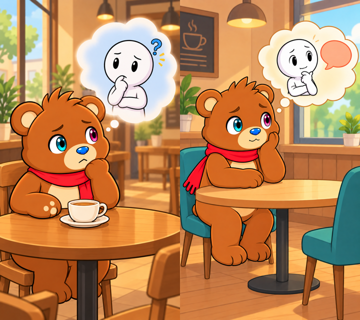
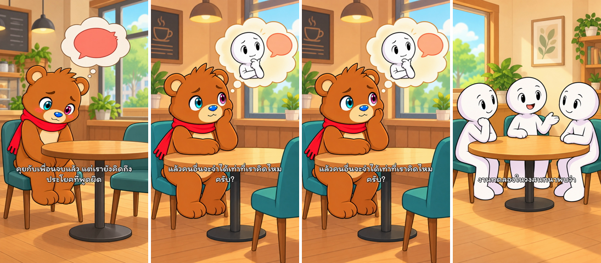

# Creator Office · Portfolio demo

Creator Office is a private application I built to turn story ideas into narrated videos. It coordinates script writing, narration, artwork, and timing. I can review proposed corrections in a dashboard and check whether they made it into the finished video.

## Demo video (2:34)

https://github.com/user-attachments/assets/4e8f8ef6-9fb2-4bf2-8710-d51cd57c2ae0

[Download the MP4](assets/creator-office-demo.mp4) · [Download English narration captions](assets/english-narration.srt)

The walkthrough features the Thai short **เราพูดผิด คนอื่นจำได้จริงหรอ?** (“Do people really remember when we misspeak?”). It includes the original Thai audio and an English walkthrough recorded in my own voice.

See more from หมีรู้เรื่อง (Bear Knows It) on [YouTube](https://www.youtube.com/@%E0%B8%AB%E0%B8%A1%E0%B8%B5%E0%B8%A3%E0%B8%B9%E0%B9%89%E0%B9%80%E0%B8%A3%E0%B8%B7%E0%B9%88%E0%B8%AD%E0%B8%87) and [Instagram](https://www.instagram.com/bearknowsitth/).

## Workflow at a glance

```text
Idea → Draft and audit the script
                 ↓
       Narration and scene planning
                 ↓
       Artwork and subtitle timing
                 ↓
       Audit and review as needed
                 ↓
       Render the MP4 → Verify the export
```

When a correction is approved, Creator Office updates the affected output and runs the relevant checks again.

### Architecture and tech stack

| Component | Technology | Role in the workflow |
| --- | --- | --- |
| Workflow orchestrator | Python, SQLite | Tracks job state, starts each job when its inputs are ready, and runs independent jobs in parallel. |
| AI requests | Python, Codex CLI, SQLite | Sends prompts and reference images for writing, artwork, and audits. Queues requests in order within each Codex session. |
| Review dashboard | HTML, CSS, JavaScript | Shows story previews, lets me approve or reject proposed corrections, and provides controls for adjusting scene timing. |
| Narration and timing | Gemini, local Whisper, Python | Gemini generates the narration. Whisper transcribes the audio locally, and Python uses that transcript to align the scenes and subtitles. |
| Video rendering | FFmpeg | Combines the selected artwork, narration, and subtitle timing into the final MP4. |

### Inside Creator Office



The Story library preview for the Thai short featured in this demo. It brings the scene artwork, narration, and subtitles together so I can inspect the composition before rendering. [Open the full-resolution screenshot](assets/creator-office-story-screen.png).

### Code excerpt · Scene boundary approval

This test covers the **Audit and review** step. I treat the script as the source of truth. A scene boundary change can move the visual cut, and the resulting scenes must still contain the exact script, including whitespace.

The test starts with two scenes, `one two six | red fox sun`. The reviewer rejects moving the first break and approves adding a break before `sun`. The expected result is `one two six | red fox | sun`. The numbers below count words in this test.

```python
# Shortened from the scene boundary approval test.
# approved_audit contains both the rejection and the approval.
fixed = apply_scene_audit_edits(separation, approved_audit)

self.assertEqual(fixed["scene_ends"], [3, 5, 6])
self.assertEqual("".join(scene["text"] for scene in fixed["scenes"]), script)
```

The first assertion checks that only the approved change took effect. The second catches accidental text edits before the scenes reach timing and rendering.

### Codex chat and queue

During drafting and audits, the **orchestrator** decides which production job is ready. The **Codex chat adapter** prepares the prompt and any reference images, starts or resumes a Codex CLI session, and reads the response events. It returns the answer, session ID, and token usage after the turn completes.

The **Codex queue** uses SQLite to admit one request at a time per session, in arrival order across workers. Two jobs resuming session A run in sequence, while a job using session B can run independently within the worker limit. Reuse waits 10 seconds after a normal call or 60 seconds after a failure or retry. The queue tracks request and timing metadata. Prompts and answers stay out of it.

```python
# Shortened from the Codex chat adapter.
with codex_slot(session):
    result = subprocess.run(
        command, input=message, capture_output=True,
        text=True, encoding="utf-8", timeout=timeout,
    )
    note_response(result)
```

The slot covers the CLI call and response bookkeeping. Before the slot is released, `note_response` records any new session ID and flags a failure so the queue can apply the correct wait. This keeps requests that share conversation history in order while independent work can proceed.

#### How the queue grants a slot

Each request gets a ticket. In this shortened excerpt from the queue, `key` identifies the session and `deadline` is the earliest time it can run.

```python
head = db.execute(
    "SELECT id FROM session_requests WHERE session = ? ORDER BY id LIMIT 1",
    (key,),
).fetchone()
ready = head is not None and head["id"] == ticket and time.time() >= deadline
```

The oldest ticket for that session can run once the cooldown ends. It stays at the head until its call finishes, so the next ticket for session A waits. Session B has its own head. The SQLite transaction ends before the CLI call begins, so workers can run both sessions at once.

## Scene 2 image audit repair



**Left:** the saved artwork before the audit repair. **Right:** the artwork used in the final video. The replacement carries the teal seating and speech bubble from the opening into the next shot. The preserved image shows what changed. The original audit wording was unavailable.

## What the render verification showed



| Check | Result on the 34.84-second Thai short |
| --- | --- |
| Scene cuts | All 14 cuts landed within one frame of their saved times. |
| Thai subtitles | All 15 cues preserved the script text and matched the saved times within 1 ms. |
| Narration | No measurable shift from the source audio across 31 sampled windows. |

These checks measure how faithfully the MP4 follows its inputs. I would still review one timing detail by ear. The saved speech alignment puts the first word of scene 2 about 0.36 seconds after its subtitle appears.

## Package contents

| File | What it contains |
| --- | --- |
| `README.md` | This case study |
| `assets/creator-office-demo.mp4` | The walkthrough with my recorded narration |
| `assets/english-narration.srt` | English walkthrough captions |
| `assets/scene-2-before-after.png` | The saved artwork comparison |
| `assets/verified-render-frames.png` | Frames decoded from the Thai short's local rerender |
| `assets/creator-office-story-screen.png` | A screenshot of the Thai short in the live Story library |

This package is for viewing the portfolio demo. The Creator Office app, full source code, configuration, and production workspace are private.
